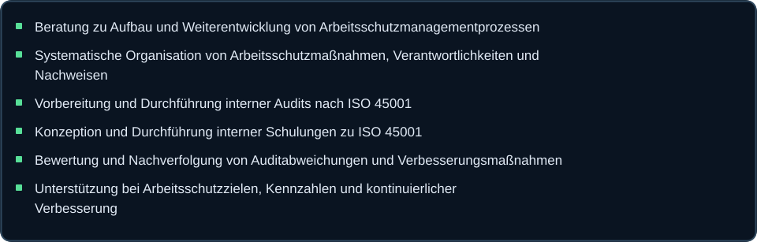

<!-- BEGIN EXPERTISE | Kompakte, funktionsfähige GitHub-Details; Hero FROZEN -->

<strong>🛡️ SiFa – Fachkraft für Arbeitssicherheit</strong> · 6 Fachbereiche

<strong>01 · Beratung &amp; Arbeitsschutzorganisation</strong> · <small>Führungskräfte, Pflichten und betriebliche Strukturen</small>

<strong>02 · Gefährdungsbeurteilungen &amp; Risikomanagement</strong> · <small>Risiken bewerten und Schutzmaßnahmen begleiten</small>

<strong>03 · Industrielle Arbeits- &amp; Anlagensicherheit</strong> · <small>Instandhaltung, Anlagenbetrieb und Revisionen</small>

<strong>04 · Betriebsbegehungen &amp; Unfallprävention</strong> · <small>Abweichungen erkennen und Verbesserungen begleiten</small>

<strong>05 · Unterweisungen, Schulungen &amp; Sicherheitskommunikation</strong> · <small>Sicherheitsvideos, Präsentationen und Schulungen</small>

<strong>06 · Arbeitsschutzmanagement &amp; ISO 45001</strong> · <small>Managementsystem, interne Audits und Verbesserung</small>

<strong>🏗️ SiGeKo – Baustellenkoordination</strong> · <small>Koordination nach Baustellenverordnung</small>

<em>Die Detailinhalte werden noch gemeinsam abgestimmt.</em>

<strong>🧯 Brandschutz</strong> · <small>Betrieblicher und baulicher Brandschutz</small>

<em>Die Detailinhalte werden noch gemeinsam abgestimmt.</em>

<strong>📋 Arbeitsschutzmanagement &amp; ISO 45001</strong> · <small>Managementsystem, Audits und Ausbildung</small>

<em>Die Detailinhalte werden noch gemeinsam abgestimmt.</em>

<strong>💻 Software Engineering &amp; AI</strong> · <small>Programmierung, Softwarearchitektur und KI</small>

<em>Die Detailinhalte werden noch gemeinsam abgestimmt.</em>

<!-- END EXPERTISE -->
