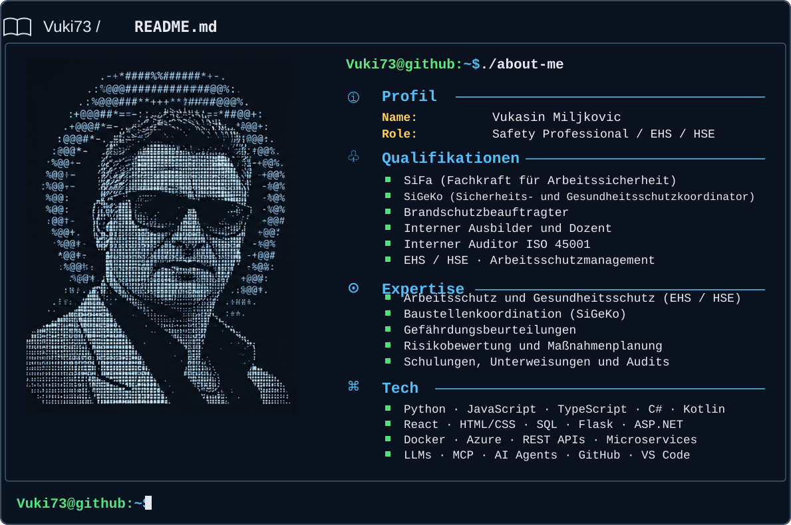

---

## 🛡️ `Vuki73@github:~$ ./sifa`

**Fachkraft für Arbeitssicherheit**  
*Betrieblicher Arbeitsschutz · Arbeitssicherheitsgesetz (ASiG) · DGUV Vorschrift 2*

<strong>01 · Beratung &amp; Arbeitsschutzorganisation</strong> — Führungskräfte, Pflichten und betriebliche Strukturen

- Beratung der Geschäftsführung und Führungskräfte zu Sicherheit und Gesundheit bei der Arbeit
- Unterstützung bei der Organisation des betrieblichen Arbeitsschutzes
- Beratung zu Arbeitgeberpflichten, Zuständigkeiten und rechtlichen Arbeitsschutzanforderungen
- Sicherheitstechnische Beratung zur Gestaltung von Arbeitsplätzen, Arbeitsverfahren und Arbeitsumgebungen
- Zusammenarbeit mit Betriebsärzten, Sicherheitsbeauftragten und weiteren betrieblichen Akteuren
- Mitwirkung im Arbeitsschutzausschuss (ASA)

<strong>02 · Gefährdungsbeurteilungen &amp; Risikomanagement</strong> — Risiken bewerten, Schutzmaßnahmen ableiten und deren Wirksamkeit begleiten

- Unterstützung bei der Erstellung, Überprüfung und Fortschreibung von Gefährdungsbeurteilungen
- Systematische Ermittlung und Bewertung von Gefährdungen bei Tätigkeiten, Arbeitsmitteln und Arbeitsverfahren
- Risikomatrizen, Maßnahmenpriorisierung und Anwendung des TOP-Prinzips
- Prüfung vorhandener Sicherheitsdatenblätter (SDB) und Betriebsanweisungen (BA) auf arbeitsschutzrelevante Angaben und Auffälligkeiten
- Beratung zur Auswahl und Anwendung geeigneter persönlicher Schutzausrüstung (PSA)
- Dokumentation, Maßnahmenverfolgung und Wirksamkeitskontrolle

<strong>03 · Industrielle Arbeits- &amp; Anlagensicherheit</strong> — Industriebetriebe, Instandhaltung und Revisionen

- Sicherheitstechnische Beratung in Industrie- und Produktionsanlagen
- Arbeitsschutzbezogene Begleitung von Instandhaltungs-, Revisions- und Stillstandsarbeiten
- Sicherheitstechnische Unterstützung bei Arbeitsfreigabe- und Erlaubnisscheinverfahren
- Last Minute Risk Assessment (LMRA) und sichere Arbeitsabläufe
- Beratung zu Schutzmaßnahmen bei Arbeiten im laufenden Anlagenbetrieb
- Arbeitsschutzbezogene Abstimmung mit Fremdfirmen im betrieblichen Anlagenumfeld

<strong>04 · Betriebsbegehungen &amp; Unfallprävention</strong> — Abweichungen erkennen und betriebliche Verbesserungen begleiten

- Durchführung sicherheitstechnischer Betriebsbegehungen
- Sicherheitstechnische Bewertung von Arbeitsplätzen, Arbeitsmitteln und Arbeitsverfahren
- Erkennen, Dokumentieren und Kommunizieren sicherheitsrelevanter Abweichungen
- Beratung zu Korrektur- und Präventionsmaßnahmen
- Maßnahmenverfolgung und Kontrolle ihrer Wirksamkeit

<strong>05 · Unterweisungen, Schulungen &amp; Sicherheitskommunikation</strong> — Schulungsmedien, Sicherheitsvideos und praktische Wissensvermittlung

- Konzeption und Durchführung betrieblicher Sicherheitsunterweisungen
- Eigenständige Erstellung vollständiger PowerPoint-Schulungspräsentationen
- Konzeption, Produktion und Einsatz von Sicherheits- und Unterweisungsvideos
- Digitale Erstunterweisungen und Sicherheitseinweisungen am Werkstor
- Schulungsmedien für Beschäftigte, Fremdfirmen und Führungskräfte
- Entwicklung visueller Lern- und Schulungskonzepte
- Dokumentation und Nachverfolgung durchgeführter Unterweisungen
- Förderung der Sicherheitskultur durch praxisnahe Medien und Kommunikation

<strong>06 · Arbeitsschutzmanagement &amp; ISO 45001</strong> — Managementsystem, interne Audits und kontinuierliche Verbesserung

- Beratung zu Aufbau und Weiterentwicklung von Arbeitsschutzmanagementprozessen
- Systematische Organisation von Arbeitsschutzmaßnahmen, Verantwortlichkeiten und Nachweisen
- Vorbereitung und Durchführung interner Audits nach ISO 45001
- Konzeption und Durchführung interner Schulungen zu ISO 45001
- Bewertung und Nachverfolgung von Auditabweichungen und Verbesserungsmaßnahmen
- Unterstützung bei Arbeitsschutzzielen, Kennzahlen und kontinuierlicher Verbesserung

> 🛡️ **10+ Years of Professional Experience**

