

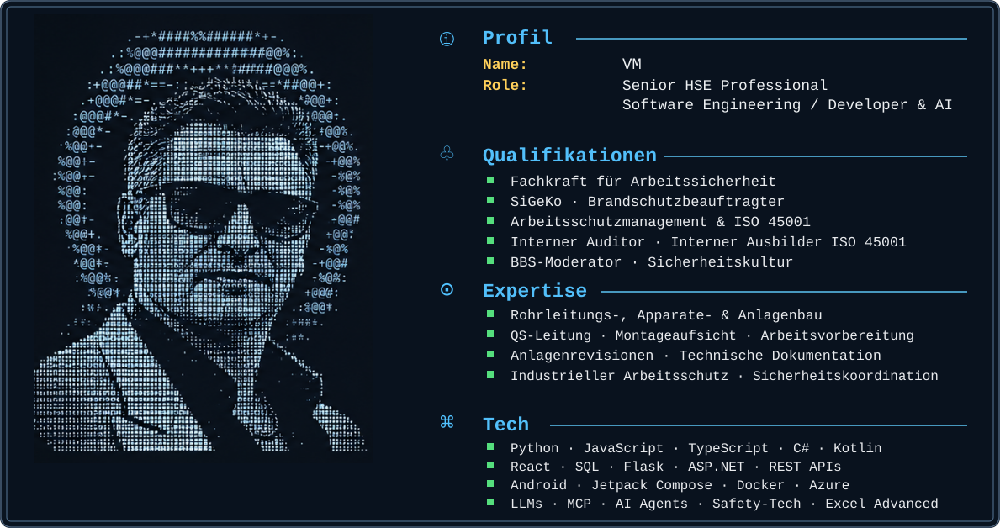

<!-- BEGIN PODCAST -->

[🎙️ **Podcast & 🎬 Erklärvideo**](https://vuki73.github.io/Vuki73/podcast/) &nbsp;·&nbsp; [🎵 **Soundtrack: „Noch ein bisschen coden“ (03:12 Uhr)**](https://vuki73.github.io/Vuki73/soundtrack/)

<!-- END PODCAST -->

<!-- BEGIN LIVE_SHOWCASE -->

[-%F0%9F%9A%80%20Live%20Web--App%20starten-ffd23f?style=for-the-badge&logo=python&logoColor=black)](https://vuki73.github.io/pcep-gehirn-trainer/)

<!-- END LIVE_SHOWCASE -->

<!-- BEGIN EXPERTISE | native GitHub one-page SiFa accordions -->

<!-- Alle fünf SiFa-Unterbereiche bleiben direkt auf dieser Profilseite. Keine Links auf HTML-Seiten. -->

<strong>01 · Beratung &amp; Arbeitsschutzorganisation</strong> · Führungskräfte, Pflichten und betriebliche Strukturen

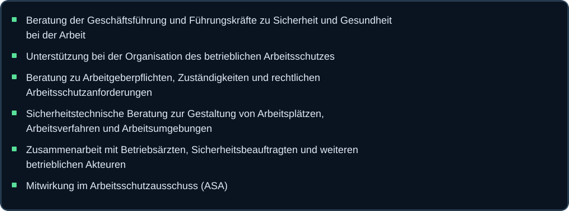

<strong>02 · Gefährdungsbeurteilungen &amp; Risikomanagement</strong> · Risiken bewerten und Schutzmaßnahmen begleiten

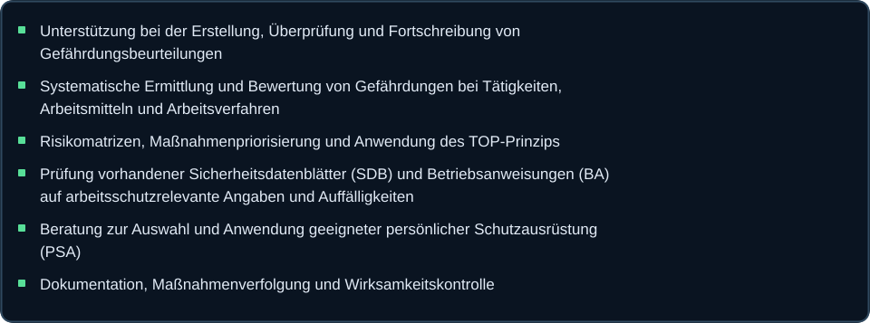

<strong>03 · Industrielle Arbeits- &amp; Anlagensicherheit</strong> · Instandhaltung, Anlagenbetrieb und Revisionen

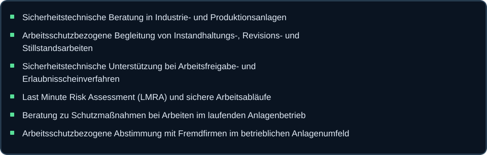

<strong>04 · Betriebsbegehungen &amp; Unfallprävention</strong> · Abweichungen erkennen und Verbesserungen begleiten

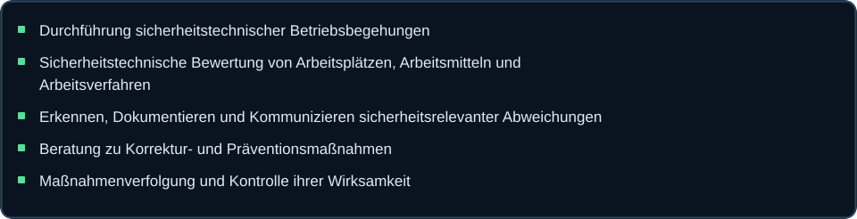

<strong>05 · Unterweisungen, Schulungen &amp; Sicherheitskommunikation</strong> · Sicherheitsvideos, Präsentationen und Schulungen

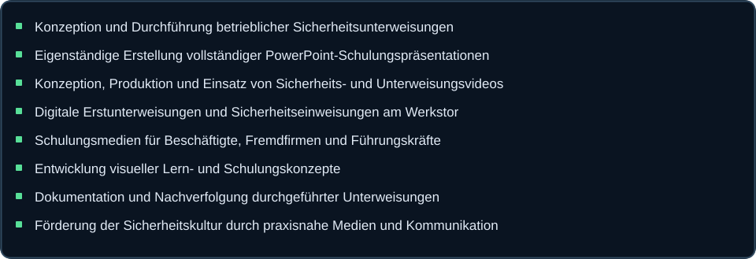

<!-- BEGIN SIGEKO | native GitHub one-page accordions; SiFa remains FROZEN -->

<strong>01 · Baustellenplanung &amp; Sicherheitskoordination</strong> · Sicherheit bereits vor Beginn der Bauarbeiten berücksichtigen

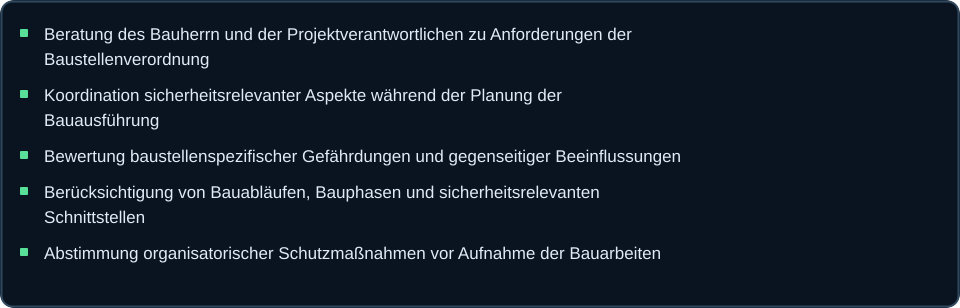

<strong>02 · Gewerke- &amp; Fremdfirmenkoordination</strong> · Zusammenarbeit unterschiedlicher Unternehmen sicher gestalten

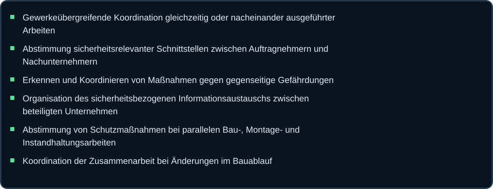

<strong>03 · SiGe-Plan &amp; Baustellendokumentation</strong> · Planung, Fortschreibung und Sicherheitsnachweise

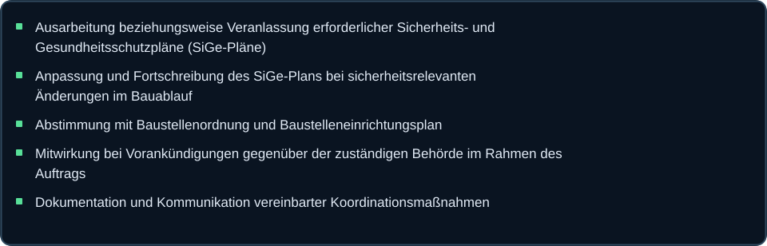

<strong>04 · Baustellenbegehungen &amp; Koordinationsbesprechungen</strong> · Sicherheitskoordination während der Bauausführung

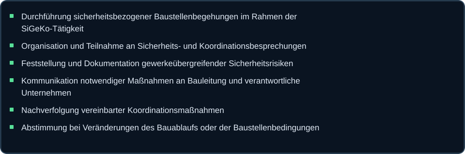

<strong>05 · Kritische Bau- &amp; Montagearbeiten</strong> · Komplexe Tätigkeiten und sicherheitsrelevante Wechselwirkungen

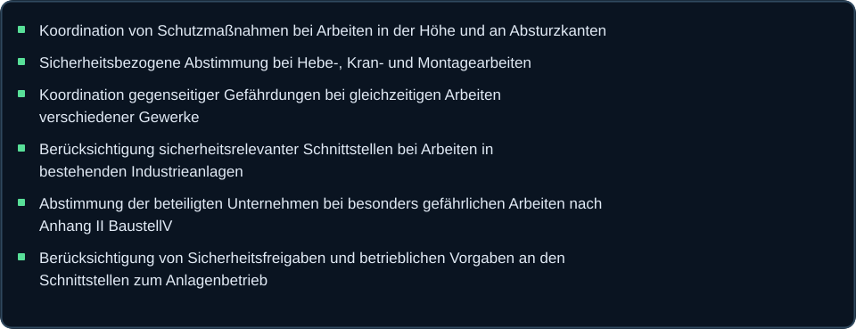

<strong>06 · Unterlage für spätere Arbeiten &amp; Projektübergabe</strong> · Sicherheit auch nach der Fertigstellung berücksichtigen

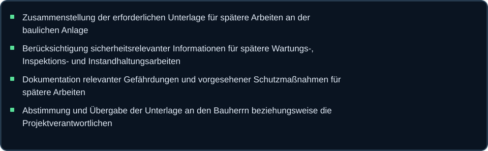

<!-- END SIGEKO -->

<!-- BEGIN BRANDSCHUTZ | native GitHub one-page accordions; FROZEN sections unchanged -->

<strong>01 · Brandschutzorganisation &amp; Koordination</strong> · Organisation und betriebliche Verantwortung

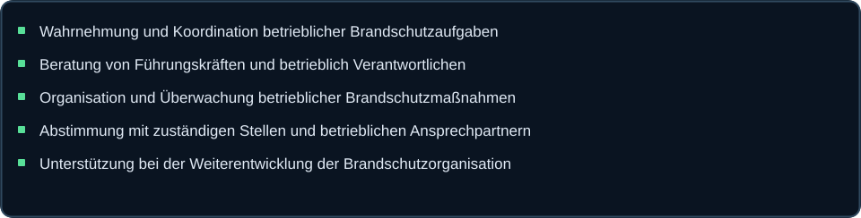

<strong>02 · Brandschutzbegehungen &amp; Mängelmanagement</strong> · Prävention, Kontrolle und Nachverfolgung

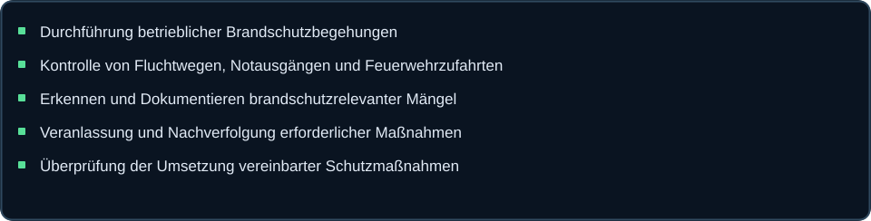

<strong>03 · Vorbeugender Brandschutz im Industriebetrieb</strong> · Brandgefährdungen und feuergefährliche Arbeiten

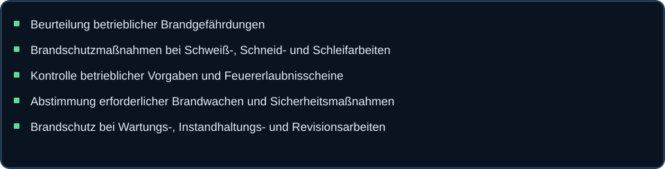

<strong>04 · Brandschutzordnung &amp; Notfallorganisation</strong> · Alarmierung, Räumung und Notfallmaßnahmen

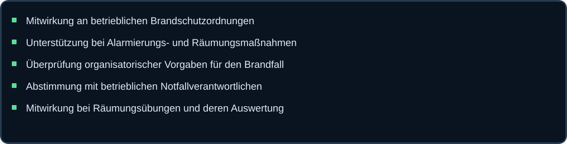

<strong>05 · Brandschutzunterweisungen, Brandschutzhelferausbildung &amp; Schulungsmedien</strong> · Gefährdungsspezifische Ausbildung, Videos und Lernmedien

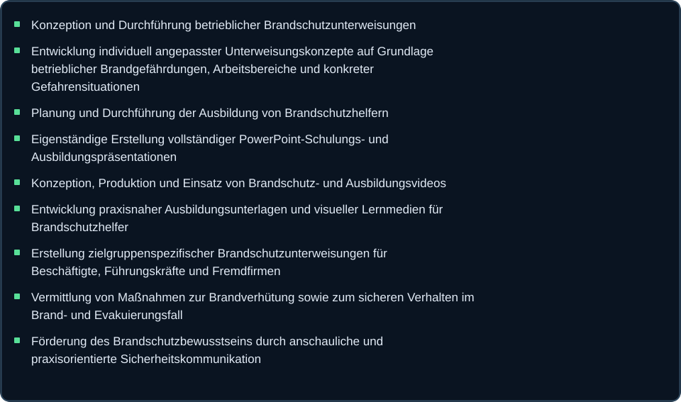

<!-- END BRANDSCHUTZ -->

<!-- BEGIN ARBEITSSCHUTZMANAGEMENT | native GitHub single-page accordions -->

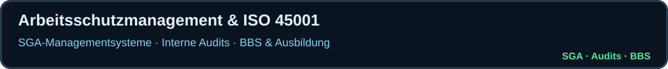

<strong>01 · SGA-Managementsysteme &amp; ISO 45001</strong> · Organisation, Prozesse und kontinuierliche Verbesserung

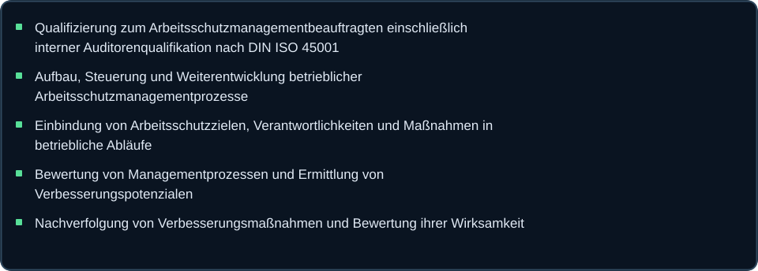

<strong>02 · Interne Audits &amp; Systembewertung</strong> · Auditmethodik und Prozessverbesserung

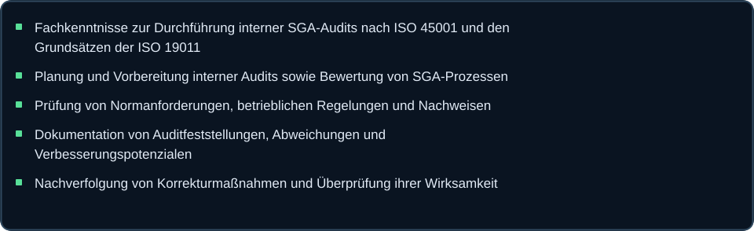

<strong>03 · BBS-Moderation &amp; Sicherheitskultur</strong> · Behavior-Based Safety und aktive Mitarbeiterbeteiligung

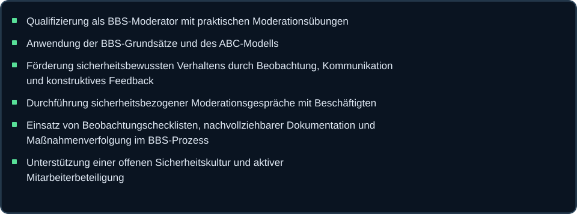

<strong>04 · Interne Ausbildung &amp; Wissensvermittlung</strong> · ISO-45001-Schulungen und digitale Schulungsmedien

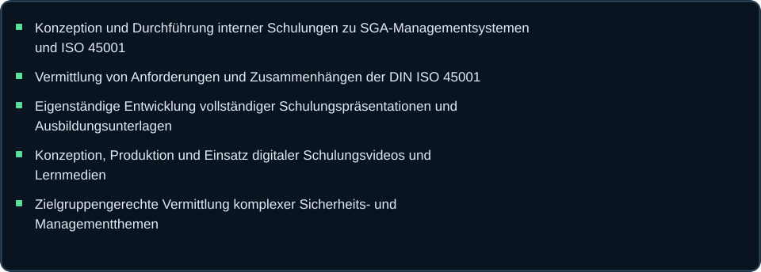

<!-- END ARBEITSSCHUTZMANAGEMENT -->

<!-- BEGIN ANLAGENBAU | native GitHub single-page accordions -->

<strong>01 · Rohrleitungs- &amp; Apparatebau</strong> · Langjährige technische Industrie- und Montagepraxis

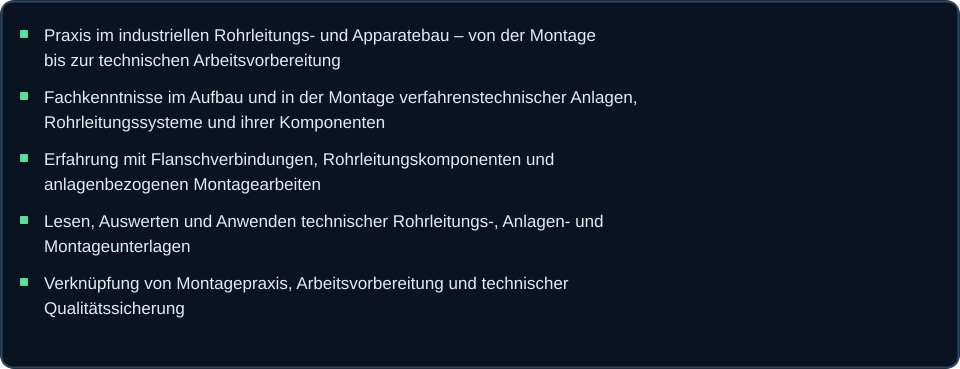

<strong>02 · Bauleitung, Montageaufsicht &amp; Baufeldführung</strong> · Operative Führung und Koordination industrieller Projekte

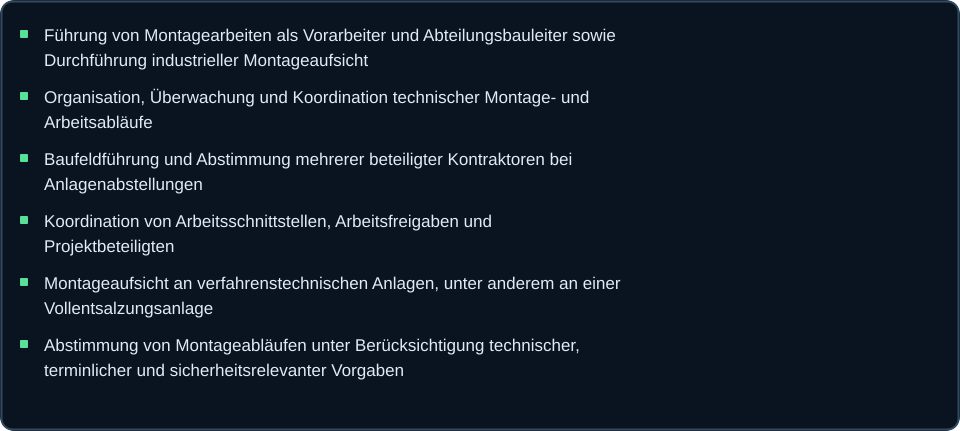

<strong>03 · Technische Arbeitsvorbereitung &amp; Prüfplanung</strong> · Planungsunterlagen, Flanschkontrollen und Prüfpunktpläne

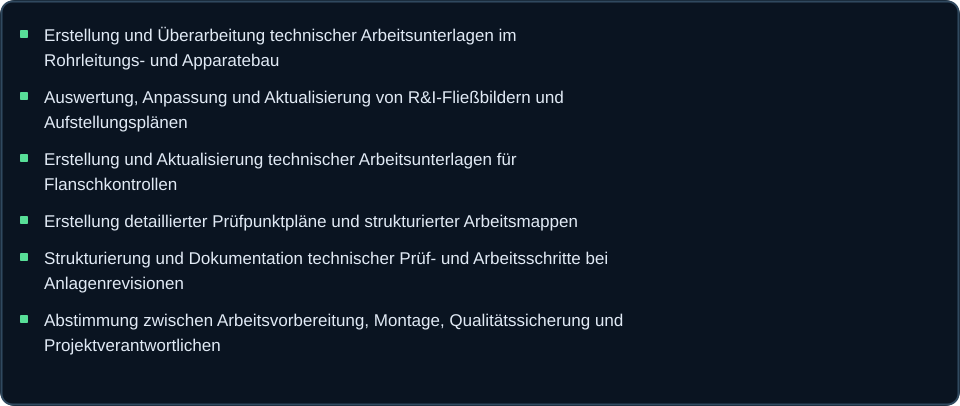

<strong>04 · QS-Leitung &amp; technische Qualitätssicherung</strong> · Leitungsverantwortung bei industriellen Anlagenabstellungen

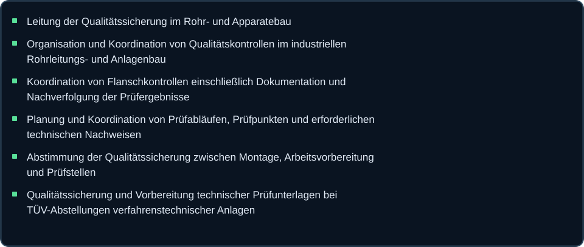

<strong>05 · Anlagenrevisionen, Dokumentation &amp; Prozessoptimierung</strong> · Turnarounds, Prüfdokumentation und effiziente Abläufe

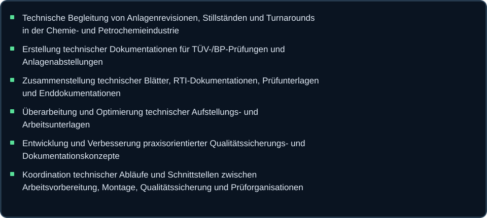

<!-- END ANLAGENBAU -->

<!-- BEGIN SOFTWARE_ENGINEERING_AI | native GitHub single-page accordions; earlier sections FROZEN -->

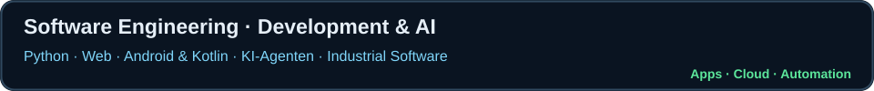

<strong>01 · Software Engineering, Architektur &amp; Algorithmen</strong> · Entwurf, Programmierung und Softwarequalität

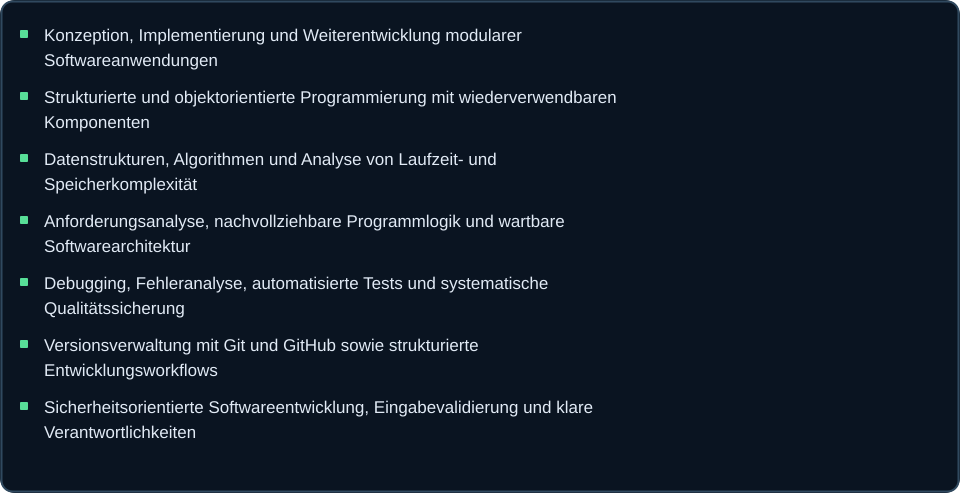

<strong>02 · Python, Datenstrukturen &amp; Automatisierung</strong> · Algorithmen, Skripte und datengetriebene Anwendungen

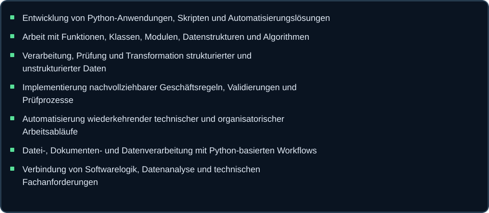

<strong>03 · Frontend Development – JavaScript, React &amp; TypeScript</strong> · Moderne Weboberflächen und interaktive Anwendungen

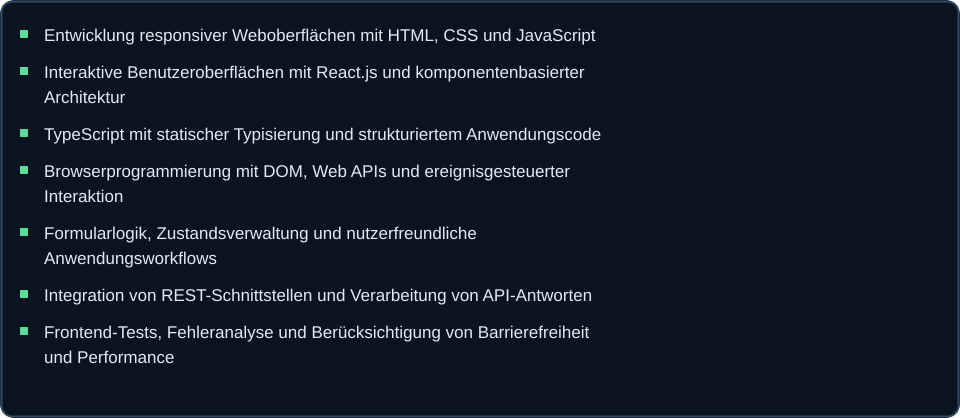

<strong>04 · Backend Development, APIs &amp; Datenbanken</strong> · Python, Flask, SQL, C# und ASP.NET

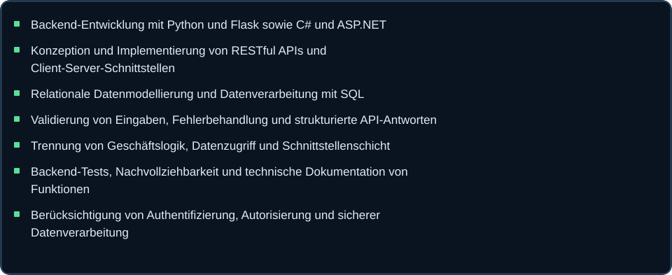

<strong>05 · Android App Development – Kotlin &amp; Jetpack Compose</strong> · Native Android-Anwendungen und Mobile Engineering

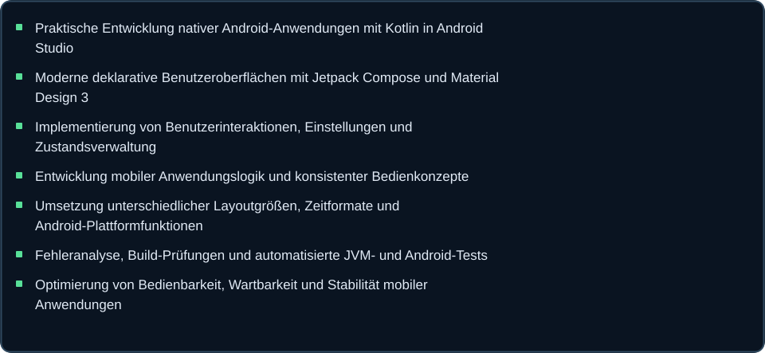

<strong>06 · Artificial Intelligence, LLMs &amp; AI Agents</strong> · KI-Integration, MCP und agentengestützte Workflows

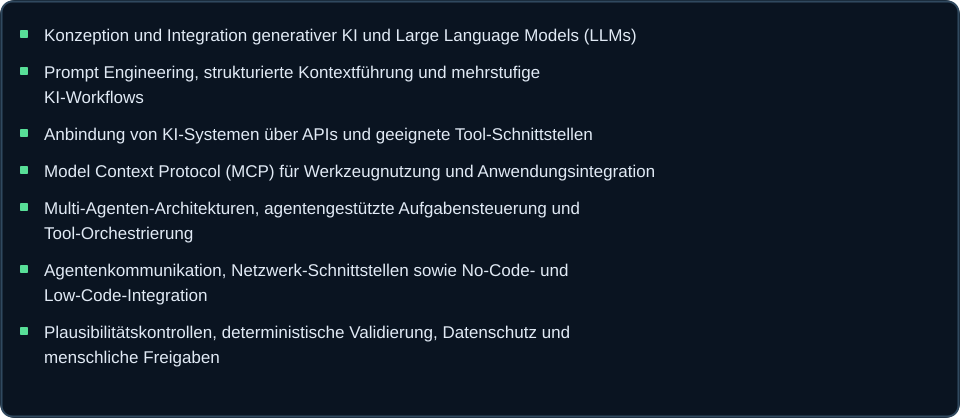

<strong>07 · Cloud, DevOps, Testing &amp; Security</strong> · Docker, Azure, Git und zuverlässiger Softwarebetrieb

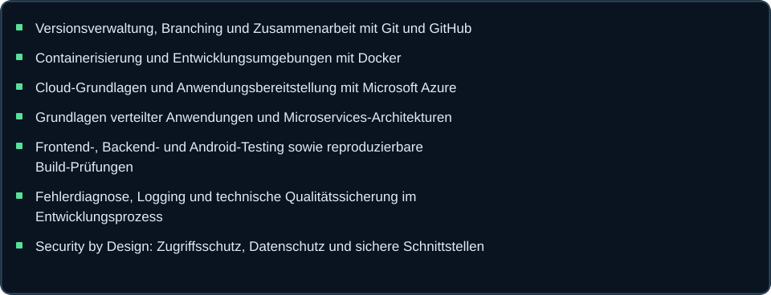

<strong>08 · Safety-Tech &amp; Industrial Software</strong> · Sicherheitstechnische Anwendungen und digitale Industrieprozesse

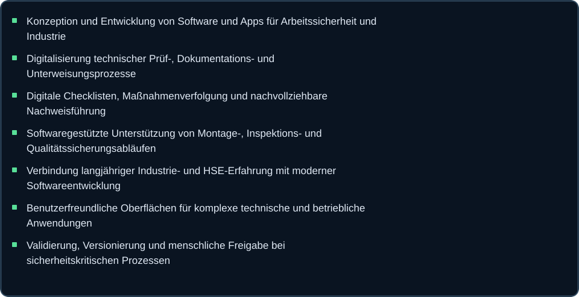

<strong>09 · Excel Advanced, Datenanalyse &amp; Projektmanagement</strong> · Tabellenmodelle, Auswertungen und digitale Arbeitsprozesse

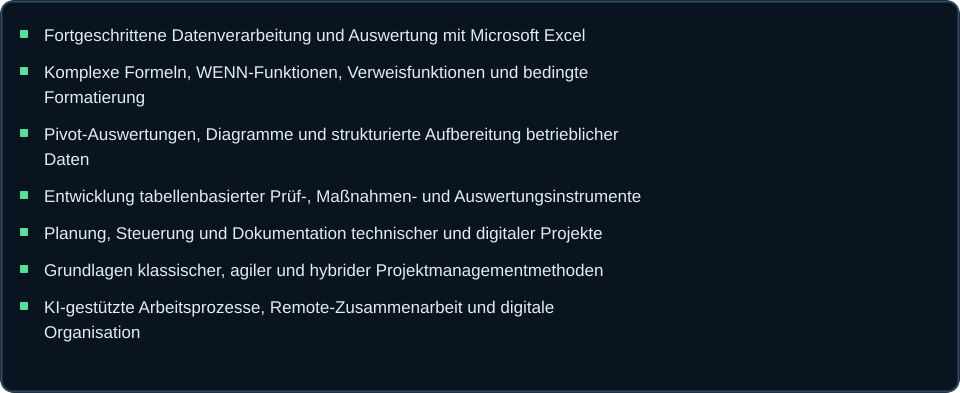

<!-- END SOFTWARE_ENGINEERING_AI -->

<!-- END EXPERTISE -->
