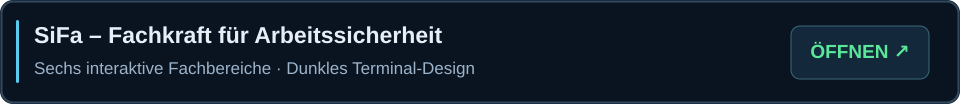

<!-- BEGIN EXPERTISE | SiFa führt zur freigegebenen interaktiven HTML-Ansicht -->

**[▶ Interaktiven SiFa-Bereich öffnen](https://vuki73.github.io/Vuki73/)**

*Die vollständig interaktive Darstellung mit sechs dunklen Klappkarten wird über GitHub Pages bereitgestellt.*

<!-- END EXPERTISE -->
